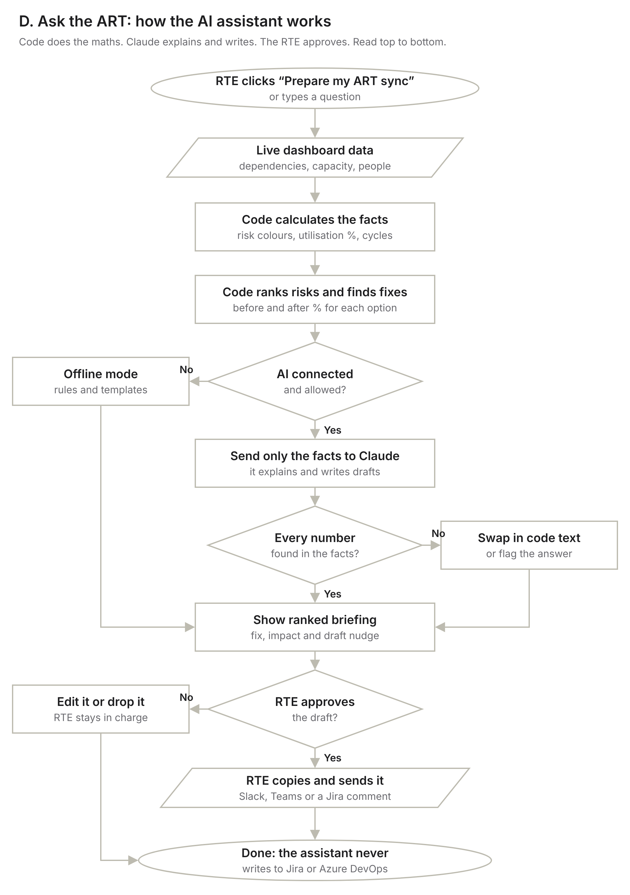

# Ask the ART: the first AI step

A small assistant inside the prototype that **prepares the Release Train Engineer's weekly ART sync**. It is not a chatbot for its own sake: it turns the dashboard into a ranked to-do list with a fix and a ready-to-send message for each risk.

## The problem it solves

Before every ART sync, an RTE spends an hour or more clicking through boards to find what is blocked, late or overloaded, then writes chaser messages team by team. The dashboard shows the data. It does not say **what to do first** or **who to nudge**.

## What it does

| Step | Who does it | Example |
|---|---|---|
| 1. Find risks | Code | `PAY-204` Key rotation was rejected by Platform |
| 2. Rank them | Code | Severity first, then how soon the sprint starts |
| 3. Work out a fix | Code | Platform can take it in S1: 64% → 82%, and it turns Green |
| 4. Explain and draft | Claude (optional) | A short headline and a friendly nudge to the Platform team |
| 5. Check the numbers | Code | Any number Claude writes that is not in the data is swapped out or flagged |
| 6. Approve and send | RTE | Edit, copy, paste into Slack, Teams or a Jira comment |

You can also ask questions such as "What is Search waiting on?". Answers cite ticket keys you can click.

## Guardrails

- **Code does the maths.** Colours, percentages, cycles and fix options never come from the AI.
- **Only facts go to the AI.** It sees a short summary of the dashboard, not raw Jira data.
- **Human in the loop.** Nothing is written to Jira or Azure DevOps. Every draft is approved and sent by a person.
- **Works without AI.** With no AI connected, the same briefing is built from rules and templates, and the page says "Offline mode".

## How AI is connected in the prototype

- Opened as a Claude artifact, the page can ask Claude through the artifact's built-in `sample` capability. The viewer is asked for permission the first time.
- Opened as a plain file, it runs in offline mode. No API key is stored in the page.
- In a real Forge app, the model call would run server-side in a Forge function with the org's approved model, and the same fact pack and number check would apply.

## Known limits (prototype)

- Sample data, with a small list of movable stories.
- The number check confirms a number exists in the data, not that it is used in the right sentence. The RTE review covers the rest.
- Suggested moves between teams assume the receiving team has the skills. The card says "check skills first".
